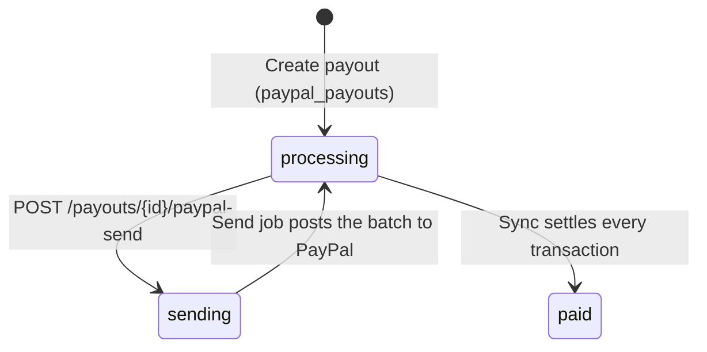

# PayPal Payouts <span class="pro-badge">PRO</span>

FluentAffiliate Pro can send a payout to PayPal through the PayPal Payouts API. PayPal then pays each affiliate at their payment email. The plugin reads the result from PayPal and marks each transaction as paid or failed.

A free alternative also exists. In the free plugin, `GET /payouts/{id}/transactions-export?format=paypal` returns the rows for a PayPal Payouts upload file. The admin uploads that file in the PayPal account by hand.

## Manual and gateway payouts

Each payout has a `payout_method`. The method controls when the referrals become paid.

| Method | Who moves the money | Referral and transaction status after "Create payout" |
|--------|---------------------|--------------------------------------------------------|
| `manual` | The admin, outside the plugin | `paid` |
| A gateway method, such as `paypal_payouts` | The gateway | `processing`, until the gateway settles each transaction |

`Helper::isGatewayPayoutMethod()` decides the type. Every key from the `fluent_affiliate/payout_methods` filter is a gateway method, except `manual`. When a payout uses a gateway method, the plugin stores `settings.gateway = true` on the payout.

## When the PayPal method is available

Pro adds the `paypal_payouts` method only when both of these conditions are true:

1. The referral setting `payout_method` is `paypal`.
2. The PayPal client ID and secret for the active mode are saved.

## Settings

The admin enters the keys under **Settings → PayPal Payouts**. The plugin stores them in the `_paypal_payouts_settings` option:

```php
[
    'mode'               => 'test',   // 'test' (Sandbox) | 'live'
    'test_client_id'     => '...',
    'test_client_secret' => '...',    // encrypted at rest
    'test_webhook_id'    => '...',    // set by the plugin, never from input
    'live_client_id'     => '...',
    'live_client_secret' => '...',    // encrypted at rest
    'live_webhook_id'    => '...',
]
```

The REST API never returns a secret. It returns the `__FA_PAYPAL_SECRET__` mask instead. If you send the mask back, the plugin keeps the stored secret.

When the admin saves new keys, the plugin does these steps:

1. It requests an access token from PayPal for each changed key pair. If PayPal refuses a pair, the plugin saves nothing.
2. If the client ID changed, it removes the old webhook at PayPal.
3. It saves the settings.
4. It registers a webhook for each configured mode that has no webhook.

A webhook problem does not stop the save. The response lists the problem in `notices`.

| Endpoint | Purpose |
|----------|---------|
| [`GET /settings/paypal-payouts`](/restapi/operations/settings/get-paypal-settings) | Read the settings and the webhook URL |
| [`POST /settings/paypal-payouts`](/restapi/operations/settings/update-paypal-settings) | Save the settings |
| [`DELETE /settings/paypal-payouts`](/restapi/operations/settings/delete-paypal-settings) | Remove the keys and the webhooks |
| [`POST /settings/paypal-payouts/test`](/restapi/operations/settings/test-paypal-connection) | Test the saved keys for one mode |
| [`POST /settings/paypal-payouts/webhook`](/restapi/operations/settings/register-paypal-webhook) | Register the webhook for one mode |

## Payout lifecycle



1. The admin creates a payout with the `paypal_payouts` method. The referrals and the transactions stay in `processing`.
2. The admin sends the payout with [`POST /payouts/{id}/paypal-send`](/restapi/operations/payouts/send-paypal-payout). The plugin moves the payout to `sending` with one conditional update, so a double click sends the payout once.
3. An Action Scheduler job (`fluent_affiliate_pro/paypal_send`) posts one PayPal batch. The batch holds every transaction in `processing`. The plugin saves the PayPal `payout_batch_id` and moves the payout back to `processing`.
4. A sync reads the batch from PayPal and settles each transaction:
   - `SUCCESS`: the transaction becomes `paid`. The action `fluent_affiliate/payout/transaction/transaction_updated_to_paid` fires.
   - `FAILED`, `BLOCKED` or `RETURNED`: the transaction becomes `failed`.
   - `PENDING`, `ONHOLD` or `UNCLAIMED`: the transaction stays `processing`.
5. When no transaction is in `processing` or `failed`, the payout becomes `paid`. A `failed` transaction keeps the payout open, because the admin must still pay or remove it.

### Limits

- One PayPal batch holds 15,000 payments at most.
- All referrals in one payout must use the same currency.
- PayPal must support the currency.
- The plugin sends only affiliates with a valid payment email. The `fluent_affiliate/payout/validated_config` filter removes the other affiliates from the payout and reports them under `skipped`. Their referrals stay unpaid.

### Safe retries

The plugin fixes the `sender_batch_id` at the first send. For 30 days, PayPal answers a repeat of the same ID with the original batch, so a retry cannot pay twice. After 30 days, PayPal accepts the same ID again. For that reason, the plugin lets the admin send an unconfirmed payout again only for 29 days after the first try. The `paypal_can_send_again` field on `GET /payouts/{id}` shows if a send is still safe.

If a send is no longer safe, the admin checks the PayPal account and uses one of these endpoints:

| Endpoint | When to use it |
|----------|----------------|
| [`POST /payouts/{id}/paypal-batch`](/restapi/operations/payouts/recover-paypal-batch) | The batch is in PayPal. Send its `batch_id`, and the plugin settles the transactions from it. |
| [`POST /payouts/{id}/paypal-not-sent`](/restapi/operations/payouts/mark-paypal-payout-not-sent) | The batch is not in PayPal. The open transactions become `failed`. The admin can then pay them by hand or remove them. |

## How results arrive

Three paths call the same sync. The sync is idempotent, so the paths can overlap.

| Path | When it runs |
|------|--------------|
| Webhook | PayPal calls `?fa_paypal_payouts_webhook=1` on the site. The plugin verifies the signature with PayPal and queues a sync 30 seconds later (`fluent_affiliate_pro/paypal_sync`). The plugin does not trust the event body. |
| Hourly job | Restarts a send job that stopped, and syncs the payouts sent in the last day. |
| Daily job | Syncs older open payouts, 50 at a time. Unclaimed payments can wait at PayPal for up to 30 days. |
| [`POST /payouts/{id}/paypal-sync`](/restapi/operations/payouts/sync-paypal-payout) | The admin clicks **Check now**. |

A local or staging site often cannot receive the webhook. On such a site, the hourly and daily jobs keep the payouts current.

## Add your own payout gateway

The PayPal integration uses only public hooks. You can use the same hooks to connect a different gateway.

1. Register the method:

   ```php
   add_filter('fluent_affiliate/payout_methods', function ($methods) {
       $methods['my_gateway'] = __('My Gateway', 'my-plugin');
       return $methods;
   });
   ```

2. Remove the affiliates that your gateway cannot pay. The same filter runs for the review screen and for "Create payout".

   ```php
   add_filter('fluent_affiliate/payout/validated_config', function ($validated, $config) {
       if ($validated['config']['payout_method'] !== 'my_gateway') {
           return $validated;
       }

       $payable = $validated['payable_affiliates']->filter(function ($affiliate) {
           return is_email($affiliate->payment_email);
       })->values();

       // an empty array, not an empty collection, so processPayout() reports "no affiliates"
       $validated['payable_affiliates']   = $payable->isEmpty() ? [] : $payable;
       $validated['payable_total_amount'] = $payable->sum('total_payable_amount');

       return $validated;
   }, 10, 2);
   ```

3. Send the `processing` transactions of the payout to your gateway. Use your own REST route or admin action.
4. When the gateway confirms a payment, call `$transaction->markAsPaid()`. This call settles the referrals, recounts the earnings, and fires `fluent_affiliate/payout/transaction/transaction_updated_to_paid`.
5. Optional: add the state that only your server knows to `GET /payouts/{id}` with the `fluent_affiliate/payout/details` filter.

## Related hooks

| Hook | Type |
|------|------|
| [`fluent_affiliate/payout_methods`](/hooks/filters/payouts#fluent-affiliate-payout-methods) | Filter |
| [`fluent_affiliate/payout/validated_config`](/hooks/filters/payouts#fluent-affiliate-payout-validated-config) | Filter |
| [`fluent_affiliate/payout/details`](/hooks/filters/payouts#fluent-affiliate-payout-details) | Filter |
| [`fluent_affiliate/payout/transaction/transaction_updated_to_{status}`](/hooks/actions/payouts#fluent-affiliate-payout-transaction-transaction-updated-to-status) | Action |
